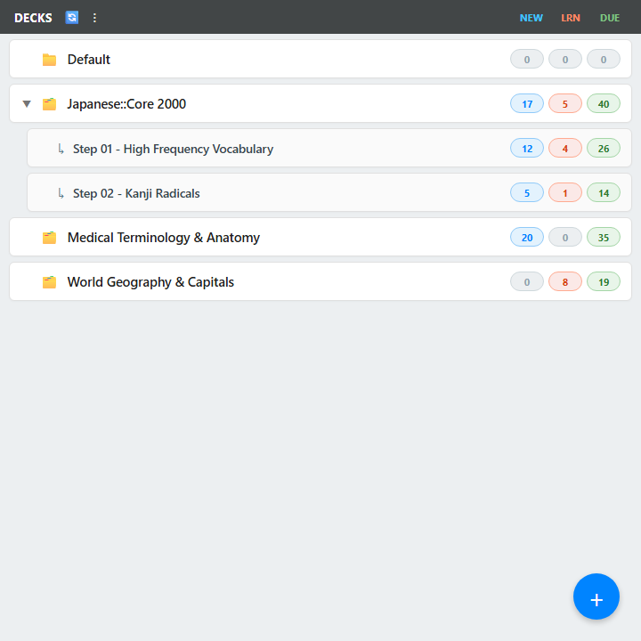
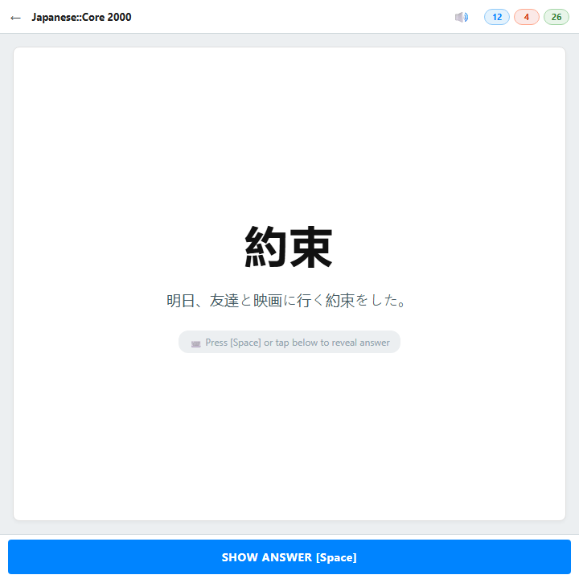
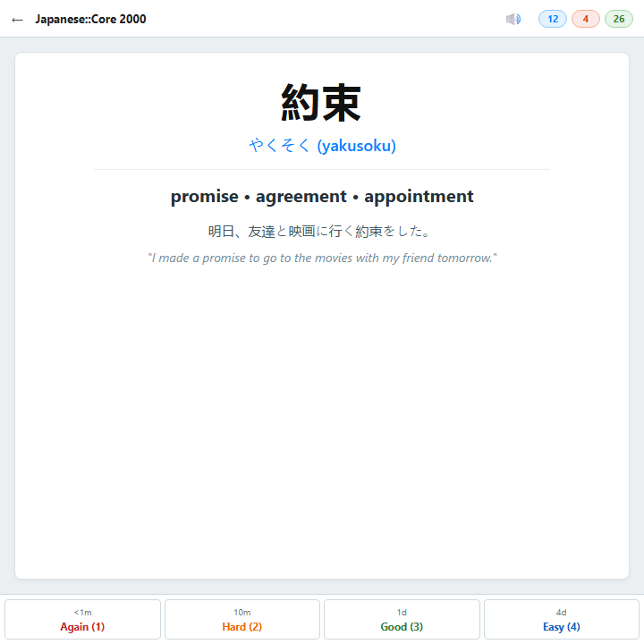

# AnkiDroid for BlackBerry 10 (Q5)

> A custom Anki flashcard app built specifically for **BlackBerry Q5 / Q10 / Classic** running the Android 4.3 runtime (BB10).

<p align="center">
  
  &nbsp;
  
  &nbsp;
  
</p>
<p align="center"><em>Deck Tree &nbsp;&bull;&nbsp; Study Front (Prompt) &nbsp;&bull;&nbsp; Study Back (Ratings)</em></p>

---

## ⚡ Features

- 📚 **Full Anki `.apkg` Deck Import**: Seamlessly import existing decks directly from storage or SD card.
- 🔄 **Two-Way Sync with AnkiWeb**: Full collection sync with intelligent upload/download merging.
- 🔀 **Offline-First**: Study without internet connection; automatically merges changes upon reconnecting.
- 🎛️ **Scheduler & Deck Settings**: Respects learning steps, new cards per day, review limits, and ease factors.
- ⌨️ **Physical Keyboard Shortcuts**:
  - `[Space]` — Show Answer / Rate "Good"
  - `[1]` — Again (`<1m`)
  - `[2]` — Hard (`10m`)
  - `[3]` — Good (`1d`)
  - `[4]` — Easy (`4d`)
  - `[R]` — Replay Audio
- 🎵 **Audio Flashcards**: Built-in audio playback for language learning and pronunciation drills.
- 🌳 **Hierarchical Deck Tree**: Collapsible nested subdecks with color-coded badges (`NEW`, `LRN`, `DUE`).
- 💾 **Persistent Session**: Keeps you logged into AnkiWeb between sessions.
- 🔒 **TLS 1.2 Backport**: Modern SSL/TLS security enabled for the legacy Android 4.3 runtime.

---

## 🏗️ Building

Requirements: Android SDK, JDK 8 or 17

```bash
./gradlew assembleDebug
```

Output APK will be placed at:
`app/build/outputs/apk/debug/app-debug.apk`

---

## 🔄 Sync Protocol

The app interfaces directly with AnkiWeb's collection sync endpoints:
- **Studied on PC & BB10**: Merges review logs, card states, and scheduler changes.
- **Studied only on PC**: Fast-forwards and downloads latest collection to device.
- **Studied only on BB10**: Pushes review logs directly up to AnkiWeb.

---

## 📲 Device Support

Engineered and optimized for **BlackBerry 10** devices running the Android 4.3 (API 18) runtime:
- BlackBerry Q5 (720×720 square screen)
- BlackBerry Q10 (720×720 square screen)
- BlackBerry Classic (720×720 square screen)
- BlackBerry Passport (1440×1440 square screen)

---

## 📄 License

MIT
